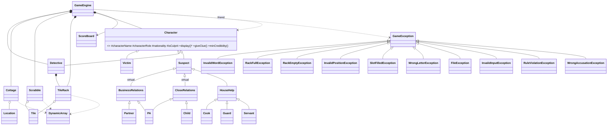

# THE LOCKER HEIST - CL1004 OOP Semester Project (Reference Solution)

Console detective game: visit 7 locations + interview 8 people, collect letters,
place them on a Scrabble board, solve two words, accuse the culprit.

## Files
| File | Purpose |
|------|---------|
| `heist.h` | structs, enums, exceptions, `DynamicArray<T>`, all class declarations |
| `heist.cpp` | implementation of every class |
| `main.cpp` | driver: creates the singleton `GameEngine`, catches all exceptions |
| `clue.txt`, `locations.txt`, `characters.txt`, `rules.txt`, `about.txt` | game data |
| `leader/scoreBoard.txt` | persistent score board (appended after each game) |

## Build and run
**Visual Studio:** new empty C++ Console project -> add `heist.h`, `heist.cpp`, `main.cpp`.
Copy all `.txt` files and the `leader` folder into the *project folder* (the working directory,
the folder that contains the `.vcxproj`). Press Ctrl+F5.

**g++ / Linux / macOS / MinGW:** `make` then `./locker_heist`  (optional: `./locker_heist 42` fixes the random seed).
Always run from this folder so the `.txt` files are found.

## Where each module lives
1 structs/enums/3 files - 2 game init (`GameEngine::startNewGame`) - 3 Character hierarchy (diamond: `PA`) -
4 `Cottage`, `Scrabble` - 5 `TileRack`, `Clue` - 6 `ScoreBoard` + file loading - 7 `GameException` family -
8 `DynamicArray<T>` (old raw-DMA code kept in comments) - 9 abstract `Character::display` -
10 composition/association/aggregation - 11 `operator==`, `TileRack::operator+`, `<<`/`>>`, `friend class GameEngine` -
12 Singleton `GameEngine` - 13 menus - 14 word formation, win/lose, score board.

## Design notes / deviations (documented as required by manual 5.2)
* `characters.txt` has **8** lines (victim + 7 suspects) because the victim gives a Word-2 letter; the manual text says 7.
* Column *k* of `locations.txt`/`characters.txt` matches line *k* of `clue.txt` (Cook, Guard, Servant, Partner 1, Partner 2, PA, Child).
  Files are validated: letters must match the chosen words, otherwise `FileException`.
* Penalties: denied interview (low credibility) and wrong accusation = -5; wrong word = -10 (values read from `rules.txt`).
* Turn counted for: collecting/re-showing a clue, forming a word, accusing, denied interview. Not counted: viewing board, answering "N", invalid input.
* Quit returns to main menu and does not write to the score board.
* Exceptions are caught in `main()`; the engine keeps its state so `run()` simply resumes after an error.
* Only `<iostream> <fstream> <string> <cstdlib> <ctime> <cctype>` are used - no STL containers/algorithms.
  
 
  

  

## Known limitations
Console only; single player; one fixed cottage layout; score file needs the `leader` folder to exist.

## UML class diagram (Mermaid - paste into draw.io / mermaid.live to export an image)

